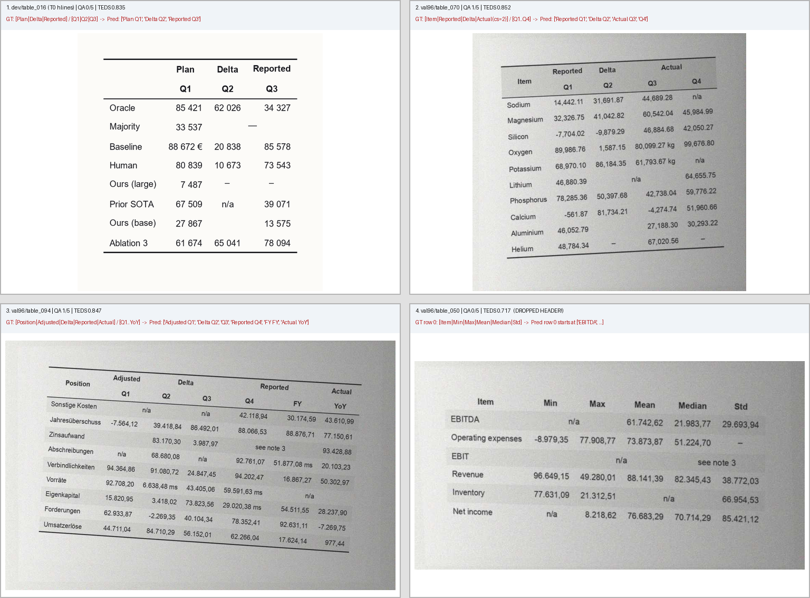
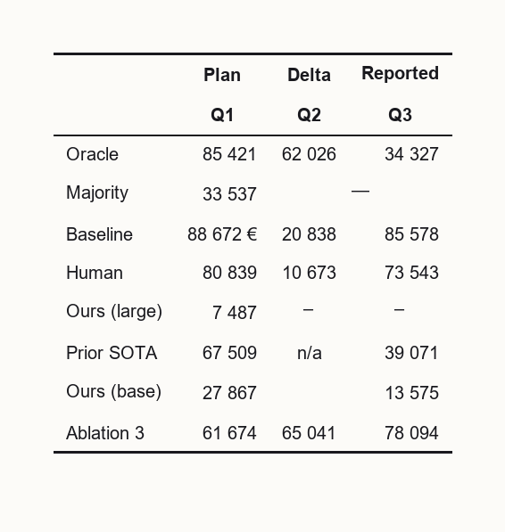
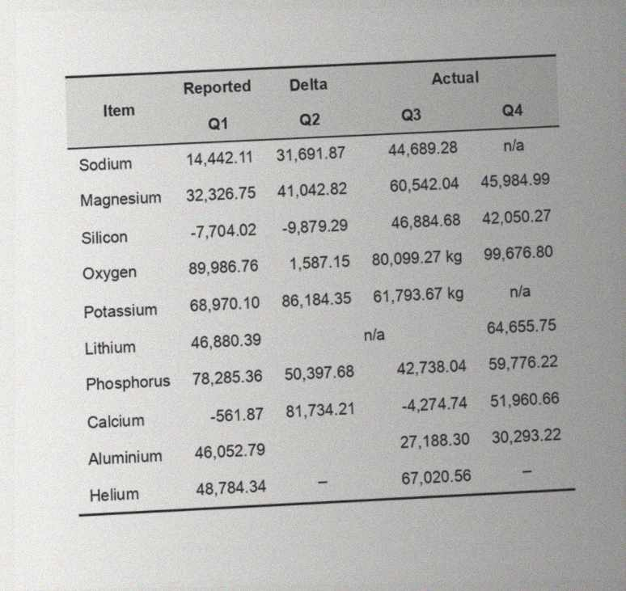
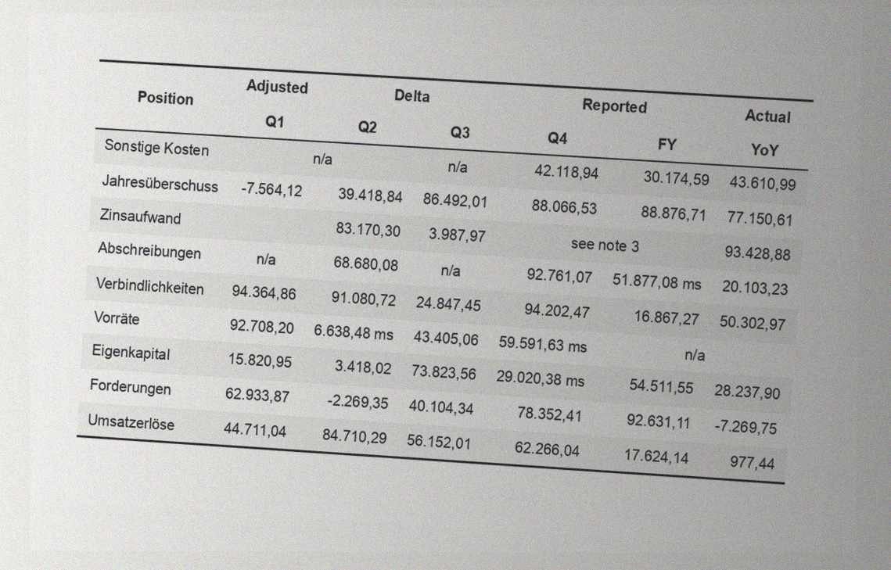
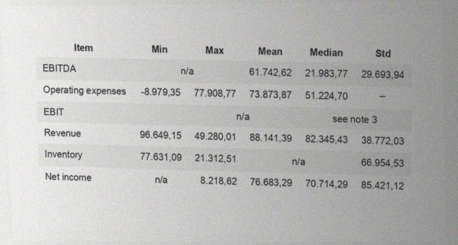

# Collapsed-Header-Row Cases (`MinerU2.5 1.2B`)

Alle 4 Header-Fehlerfälle aus `challenge/ERRORS.md` (100 % der `dev`-QA-Fehler + 15/19 der `val96`-QA-Fehler) inklusive der `val96`-Bilder, GT-HTML, GT-QA und MinerU2.5-Predictions zum direkten Reproduzieren.



## Überblick

| Fall | Fehlertyp | TEDS | GT-Zeilen | Pred-Zeilen | QA | Bild | Repro-JSON |
|---|---|---:|---:|---:|---:|---|---|
| `dev_table_016` | `collapsed-header-row` | 0.8352 | 10 | 9 | 0/5 | [dev_table_016.png](dev_table_016.png) | [dev_table_016.json](dev_table_016.json) |
| `val96_table_070` | `collapsed-header-row` | 0.8522 | 12 | 11 | 1/5 | [val96_table_070.jpg](val96_table_070.jpg) | [val96_table_070.json](val96_table_070.json) |
| `val96_table_094` | `collapsed-header-row` | 0.8472 | 11 | 10 | 1/5 | [val96_table_094.jpg](val96_table_094.jpg) | [val96_table_094.json](val96_table_094.json) |
| `val96_table_050` | `dropped-header-row` | 0.7174 | 7 | 6 | 0/5 | [val96_table_050.jpg](val96_table_050.jpg) | [val96_table_050.json](val96_table_050.json) |

## Kernbeobachtung

- **3 echte `collapsed-header-row`-Fälle** (`dev_table_016`, `val96_table_070`, `val96_table_094`): Zwischen Ober- und Unter-Header gibt es im Bild **keine horizontale Linie** (`hlines` / `borderless`). MinerU2.5 liest jeden Buchstaben und jede Zahl korrekt, zieht aber z. B. `Plan` + `Q1` in eine einzelne Zelle `'Plan Q1'` zusammen. `eval_qa.py` findet dadurch die Spaltenköpfe (`Q1`, `Q2`, `Q3`, `FY`, `YoY`) nicht → 0/5 bzw. 1/5 QA.
- **1 anderer Fall (`val96_table_050`)**: Tatsächlich ein 1-zeiliger Header (`Item | Min | Max | Mean | Median | Std`), den MinerU2.5 auf dem schrägen, kontrastarmen Handyfoto **komplett gedroppt** hat (`dropped-header-row`).

## Details pro Fall

### `dev_table_016` (`collapsed-header-row` · TEDS 0.8352 · QA 0/5)



```text
GT row 0  : [(0, 2, 1, ''), (1, 1, 1, 'Plan'), (2, 1, 1, 'Delta'), (3, 1, 1, 'Reported')]
GT row 1  : [(1, 1, 1, 'Q1'), (2, 1, 1, 'Q2'), (3, 1, 1, 'Q3')]
Pred row 0: ['', 'plan q1', 'delta q2', 'reported q3']
Pred row 1: ['oracle', '85 421', '62 026', '34 327']
```

### `val96_table_070` (`collapsed-header-row` · TEDS 0.8522 · QA 1/5)



```text
GT row 0  : [(0, 2, 1, 'Item'), (1, 1, 1, 'Reported'), (2, 1, 1, 'Delta'), (3, 1, 2, 'Actual')]
GT row 1  : [(1, 1, 1, 'Q1'), (2, 1, 1, 'Q2'), (3, 1, 1, 'Q3'), (4, 1, 1, 'Q4')]
Pred row 0: ['item', 'reported q1', 'delta q2', 'actual q3', 'q4']
Pred row 1: ['sodium', '14,442.11', '31,691.87', '44,689.28', 'n/a']
```

### `val96_table_094` (`collapsed-header-row` · TEDS 0.8472 · QA 1/5)



```text
GT row 0  : [(0, 2, 1, 'Position'), (1, 1, 1, 'Adjusted'), (2, 1, 2, 'Delta'), (4, 1, 2, 'Reported'), (6, 1, 1, 'Actual')]
GT row 1  : [(1, 1, 1, 'Q1'), (2, 1, 1, 'Q2'), (3, 1, 1, 'Q3'), (4, 1, 1, 'Q4'), (5, 1, 1, 'FY'), (6, 1, 1, 'YoY')]
Pred row 0: ['position', 'adjusted q1', 'delta q2', 'q3', 'reported q4', 'fy fy', 'actual yoy']
Pred row 1: ['sonstige kosten', 'n/a', 'n/a', 'n/a', '42.118,94', '30.174,59', '43.610,99']
```

### `val96_table_050` (`dropped-header-row` · TEDS 0.7174 · QA 0/5)



```text
GT row 0  : [(0, 1, 1, 'Item'), (1, 1, 1, 'Min'), (2, 1, 1, 'Max'), (3, 1, 1, 'Mean'), (4, 1, 1, 'Median'), (5, 1, 1, 'Std')]
GT row 1  : [(0, 1, 1, 'EBITDA'), (1, 1, 2, 'n/a'), (3, 1, 1, '61.742,62'), (4, 1, 1, '21.983,77'), (5, 1, 1, '29.693,94')]
Pred row 0: ['ebitda', 'n/a', '61.742,62', '21.983,77', '29.693,94']
Pred row 1: ['operating expenses', '-8.979,35', '77.908,77', '73.873,87', '51.224,70']
```
